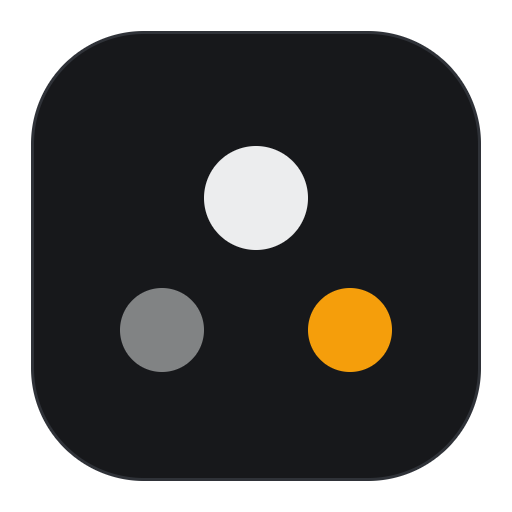
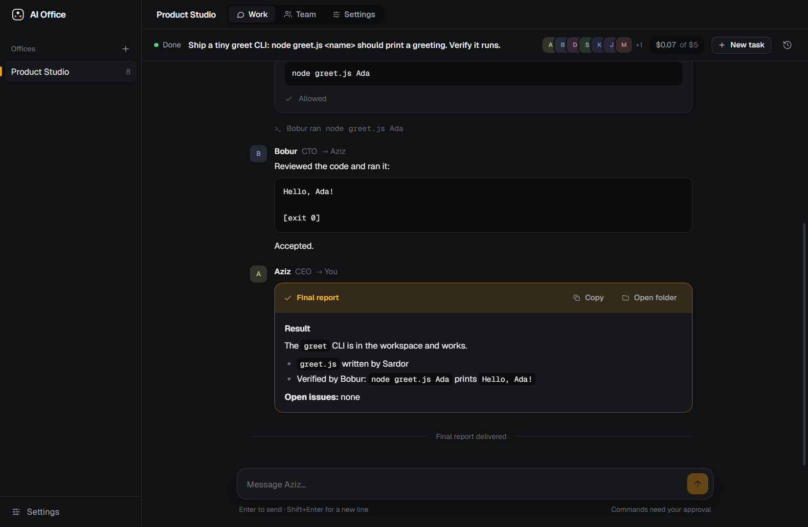
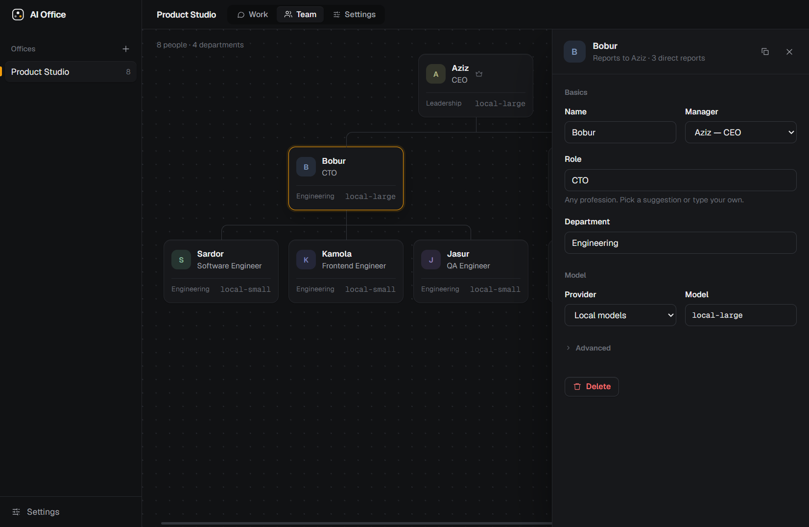

<p align="center">
  
</p>

<h1 align="center">AI Office</h1>

<p align="center">
  A desktop app where AI models work together like an office.<br>
  You give the goal. The CEO splits the work, the team builds and reviews it, and you get a report.
</p>

<p align="center">
  <a href="README.uz.md">O‘zbekcha</a> ·
  <a href="#quick-start">Quick start</a> ·
  <a href="#extending">Extending</a> ·
  <a href="#security">Security</a>
</p>



## Why

Using several AI models together usually means many chat windows and copy-pasting answers between them. AI Office puts them in one team instead:

- **Real roles.** Every member has a name, a job title, a department and a manager. Any profession works: engineer, designer, lawyer, accountant, pentester.
- **Mix models freely.** Use a strong model for managers and cheaper ones for the people doing the work. One model can fill many roles.
- **They talk to each other.** Managers delegate and review, colleagues ask each other questions across departments, reports go up the chain. You only see a calm conversation, not a cockpit.
- **They do real work.** Read, write and search files, run commands (with your approval), fetch web pages, use skills and MCP tools.
- **They learn.** Lessons a member saves are given back to them in later work.

## Quick start

Requires Node.js 22 or newer.

```bash
git clone https://github.com/NeoCode-02/ai-office.git
cd ai-office
npm install
npm run dev
```

Or download an installer from [Releases](https://github.com/NeoCode-02/ai-office/releases). The builds are not code-signed yet, so Windows and macOS show an "unknown publisher" warning the first time.

Then:

1. **Settings → AI providers** — add an API key. Supported out of the box: Anthropic (Claude), OpenAI, Google Gemini, DeepSeek, Kimi, GLM, OpenRouter, xAI, Mistral, Groq, Ollama, and any other OpenAI-compatible endpoint.
2. **New office** — pick a workspace folder and a team template.
3. **Work** — tell the CEO what you want. Approve commands when asked. Read the final report.



## How it works

```
You ──goal──▶ CEO ──task──▶ Department head ──task──▶ Team member
 ▲             │                  ▲  │                      │
 └──report─────┘                  │  └──review / feedback───┤
                                  └──────────report─────────┘
```

- Each member has a private conversation with their own model, so provider-specific details (reasoning, tool calls) stay intact.
- Messages between members go through a shared channel that you see in real time. Members wake up when someone writes to them and work in parallel.
- Work stops when the CEO delivers the final report, the budget runs out, or you press Stop. Write again to continue.

Only two adapters are needed: the official `openai` SDK for every OpenAI-compatible API and the official `@anthropic-ai/sdk` for Claude.

## Extending

Everything works without extensions. When you need more, go to **Settings → Extensions**:

| | What it is | How to add |
|---|---|---|
| **MCP servers** | Tools such as GitHub, databases or browsers via the [Model Context Protocol](https://modelcontextprotocol.io). Local (stdio) or remote (HTTP) servers. | Add a server, then tick it for the members who may use it. |
| **Skills** | Reusable know-how in the Agent Skills format: a folder with a `SKILL.md`. Members see each skill's description and load the full text when needed. | Import a folder or write one in the app. Four skills ship built in. |
| **Plugins** | Folders in the Claude Code plugin layout. Their `skills/`, `.mcp.json` and `agents/` (as role templates) are added. | Import the plugin folder. Commands and hooks are not used. |


## Security

- API keys, MCP environment variables and headers are encrypted with the operating system's keychain (`safeStorage`) and never leave your computer except to the provider you configured.
- File tools are confined to the office's workspace folder, including through symlinks.
- Terminal commands and MCP tool calls ask for your approval by default. **Automatic mode is not a sandbox** — only use it for work you trust.
- Text from imported skills, plugins, fetched web pages and files is given to the models. Only import extensions you trust.

To report a vulnerability, see [SECURITY.md](SECURITY.md).

## Development

| Command | What it does |
|---|---|
| `npm run dev` | Run with hot reload |
| `npm run lint` · `npm run typecheck` · `npm test` | Checks (CI runs all three plus the build) |
| `npm run build` | Production build into `out/` |
| `npm run dist` | Installer for the current OS into `dist/` |

Set `AI_OFFICE_DATA=<folder>` to keep app data somewhere else (useful for testing).

```
src/main/       Electron main: providers, office orchestration, tools, MCP client, extensions, storage
src/preload/    The typed bridge exposed to the UI
src/renderer/   React UI (no UI framework, plain CSS)
src/shared/     Types shared by both sides
```

See [CONTRIBUTING.md](CONTRIBUTING.md) before opening a pull request.

## Light and dark

The app follows your system theme.


## License

[MIT](LICENSE)
