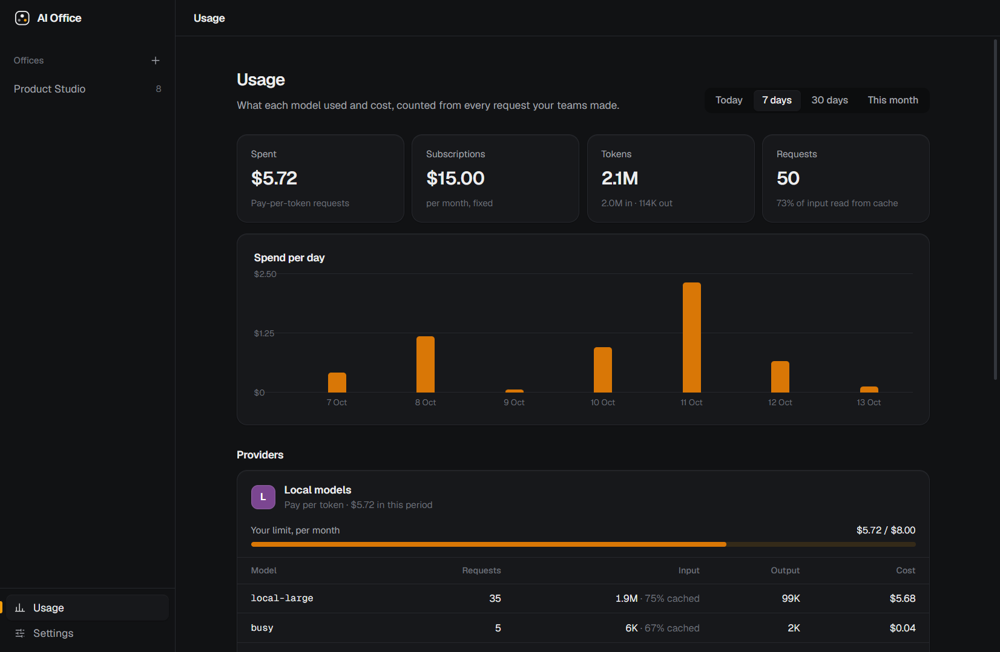
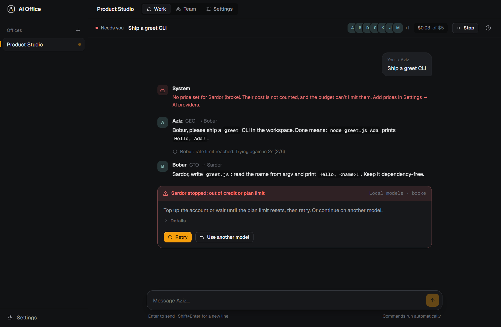
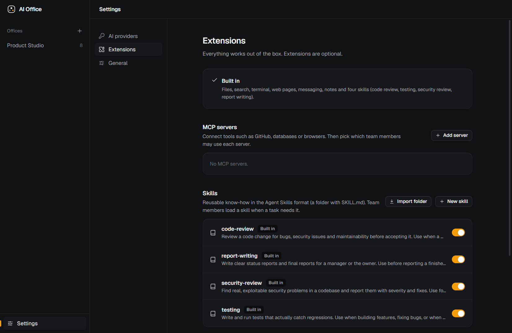
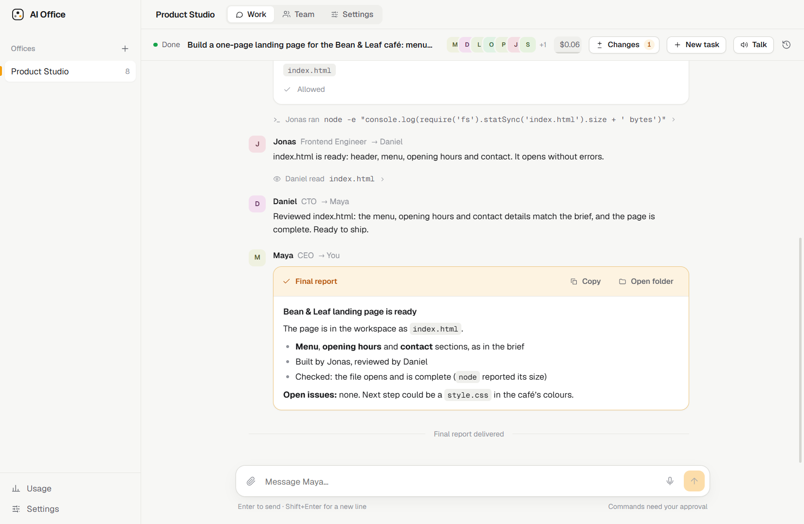

<p align="center">
  
</p>

<h1 align="center">AI Office</h1>

<p align="center">
  A desktop app where AI models work together like an office.<br>
  You give the goal. The CEO splits the work, the team builds and reviews it, and you get a report.
</p>

<p align="center">
  <a href="README.uz.md">O‘zbekcha</a> ·
  <a href="#quick-start">Quick start</a> ·
  <a href="#costs-and-limits">Costs and limits</a> ·
  <a href="#extending">Extending</a> ·
  <a href="#security">Security</a>
</p>


## Why

Using several AI models together usually means many chat windows and copy-pasting answers between them. AI Office puts them in one team instead:

- **Real roles.** Every member has a name, a job title, a department and a manager. Any profession works: engineer, designer, lawyer, accountant, pentester.
- **Mix models freely.** Use a strong model for managers and cheaper ones for the people doing the work. One model can fill many roles.
- **They talk to each other.** Managers delegate and review, colleagues ask each other questions across departments, reports go up the chain. You only see a calm conversation, not a cockpit.
- **They do real work.** Read, write and search files, run commands (with your approval), fetch web pages, use skills and MCP tools.
- **They learn.** Lessons a member saves are given back to them in later work.
- **You stay in control.** Plan mode (the CEO's plan needs your OK before anything changes), approvals with "always allow", a request limit and a guard against members chatting in circles, a budget per office and daily/monthly spending caps for the whole app.
- **Undo is one click.** Each task starts from a snapshot of the workspace: see every changed file with its diff, undo one file or all of them, or commit the result to your own Git repository.

## Quick start

## Quick start

Requires Node.js 22 or newer.

```bash
git clone https://github.com/NeoCode-02/ai-office.git
cd ai-office
npm install
npm run dev
```

Or download an installer from [Releases](https://github.com/NeoCode-02/ai-office/releases). The builds are not code-signed yet, so Windows and macOS show an "unknown publisher" warning the first time.

Then:

1. **Settings → AI providers** — add an API key. Supported out of the box: Anthropic (Claude), OpenAI, Google Gemini, DeepSeek, Kimi, GLM, OpenRouter, xAI, Mistral, Groq, Ollama, and any other OpenAI-compatible endpoint.
2. **New office** — pick a workspace folder and a team template.
3. **Work** — tell the CEO what you want. Approve commands when asked. Read the final report.


## How it works

```
You ──goal──▶ CEO ──task──▶ Department head ──task──▶ Team member
 ▲             │                  ▲  │                      │
 └──report─────┘                  │  └──review / feedback───┤
                                  └──────────report─────────┘
```

- Each member has a private conversation with their own model, so provider-specific details (reasoning, tool calls) stay intact.
- Messages between members go through a shared channel that you see in real time. Members wake up when someone writes to them and work in parallel.
- Work stops when the CEO delivers the final report, the budget runs out, or you press Stop. Write again to continue.

Only two adapters are needed: the official `openai` SDK for every OpenAI-compatible API and the official `@anthropic-ai/sdk` for Claude.

## Costs and limits

Every request is logged with the tokens the provider reported, and **Usage** shows spend per day, per model and per team member.

- **How you pay is set per provider:** pay per token (with model prices), a subscription (flat monthly fee, optional plan limit such as "120 requests per 5 hours"), or free (local models).
- **Prices are per model, per provider.** Claude prices are built in; for other models type them in or fill them from OpenRouter's public catalog (only exact matches are filled). Cache reads and writes are priced separately. A model without a price shows as *unknown*, never as $0.
- **Remaining balance** comes straight from the provider where its API offers it (DeepSeek, Kimi, OpenRouter key limit). Elsewhere you can set your own monthly or plan limit, tracked from this app's usage.
- **When a model fails:** rate limits and provider outages are retried automatically (up to six times, honouring `retry-after`). If credit runs out, the key is rejected or the model is gone, the member switches to its **backup model** with a log of its work so far. Without a backup the member stops and asks you to retry or pick another model; the rest of the run waits.





## Working with a team

- **Plan mode** (office settings): the CEO proposes a plan with `propose_plan` and, until you approve it, can only read: no files written, no commands, no MCP tools, no delegating. You approve or send feedback.
- **Approvals**: commands, MCP tools and fetches of this computer or the local network ask first. "Always allow" remembers the command (also with more arguments), the tool or the host for this office; the list is in office settings.
- **Changes**: the Changes panel lists the files the task added, changed or deleted, with diffs. Undo one file or all; snapshots live in a separate repository, your own `.git` is never touched. Workspaces over 20,000 files or 1 GB are not snapshotted (the task still runs).
- **Long tasks**: when a member's conversation gets long it is summarized and restarted (compaction), so long work does not hit the model's limit.
- **Docker sandbox** (optional, office settings): `run_command` runs in a container with only the workspace mounted (its `.git` read-only) and no network unless you allow it.
- **History**: search past tasks, export one as Markdown, or export a whole office (team, briefing, settings) to share it. Imports never bring permissions or MCP access with them.
- **Notifications and theme**: desktop notifications when the window is in the background (approval, plan, blocked member, final report, stop), light/dark/system theme, and an update check once a day (Settings → General).

## Extending

Everything works without extensions. When you need more, go to **Settings → Extensions**:

| | What it is | How to add |
|---|---|---|
| **MCP servers** | Tools such as GitHub, databases or browsers via the [Model Context Protocol](https://modelcontextprotocol.io). Local (stdio) or remote (HTTP) servers. | Add a server, then tick it for the members who may use it. |
| **Skills** | Reusable know-how in the Agent Skills format: a folder with a `SKILL.md`. Members see each skill's description and load the full text when needed. | Import a folder or write one in the app. Four skills ship built in. |
| **Plugins** | Folders in the Claude Code plugin layout. Their `skills/`, `.mcp.json` and `agents/` (as role templates) are added. | Import the plugin folder. Commands and hooks are not used. |



## Security

- API keys, MCP environment variables and headers are encrypted with the operating system's keychain (`safeStorage`) and never leave your computer except to the provider you configured.
- File tools are confined to the office's workspace folder: symlinks are resolved (also in folders that don't exist yet), writing inside `.git` is refused, FIFOs and devices are refused, and file tools wait while a command runs in the same workspace so a command can't swap a folder for a symlink mid-check.
- `web_fetch` resolves each host once and pins the address. Link-local, multicast and reserved addresses (cloud metadata services) are never fetched; this computer (including its own public addresses) and the local network need your approval. Redirects are checked again; responses are capped at 2 MB.
- Terminal commands, MCP tool calls and local fetches ask for your approval by default. **Automatic mode is not a sandbox**, and neither are MCP servers: they run with your permissions. The optional Docker sandbox only covers `run_command`.
- The main process only answers its own window, and checks the shape of every argument it receives.
- Text from imported skills, plugins, offices, fetched web pages and files is given to the models. Only import what you trust.

To report a vulnerability, see [SECURITY.md](SECURITY.md).

## Development

| Command | What it does |
|---|---|
| `npm run dev` | Run with hot reload |
| `npm run lint` · `npm run typecheck` · `npm test` | Checks (CI runs all three plus the build) |
| `npm run build` | Production build into `out/` |
| `npm run e2e` | Builds, then drives the app end to end against a fake provider (`e2e/run.mjs`) |
| `npm run dist` | Installer for the current OS into `dist/` |

Set `AI_OFFICE_DATA=<folder>` to keep app data somewhere else (useful for testing).

```
src/main/       Electron main: providers, office orchestration, tools, MCP client, extensions, storage
src/preload/    The typed bridge exposed to the UI
src/renderer/   React UI (no UI framework, plain CSS)
src/shared/     Types shared by both sides
```

See [CONTRIBUTING.md](CONTRIBUTING.md) before opening a pull request.

## Light and dark

The app follows your system theme.



## License

[MIT](LICENSE)
