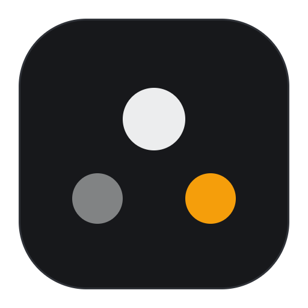
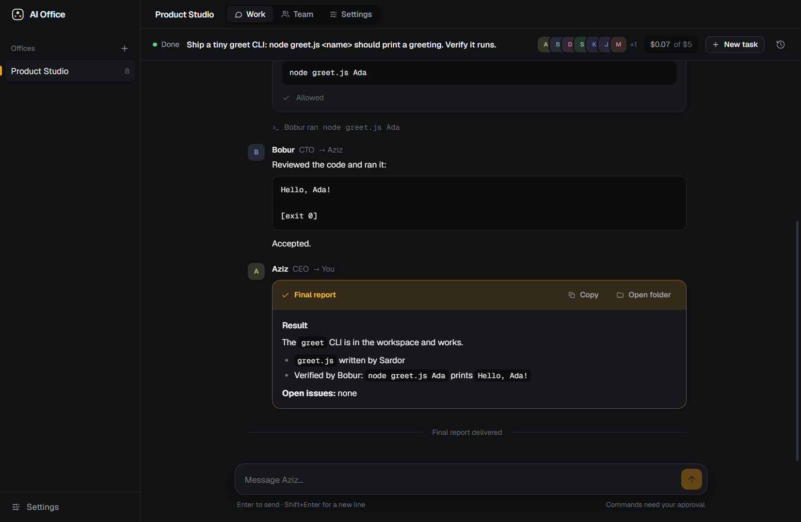
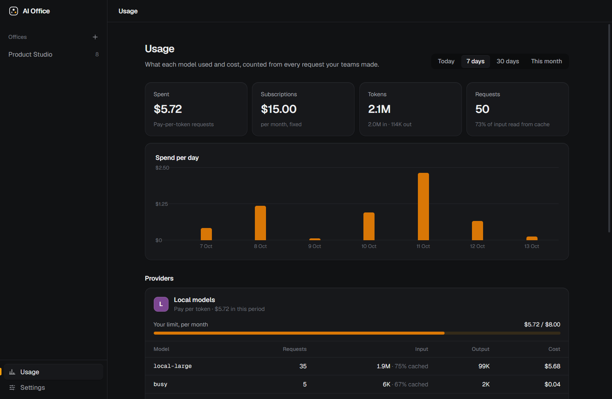

<p align="center">
  
</p>

<h1 align="center">AI Office</h1>

<p align="center">
  AI modellar ofisdek birga ishlaydigan desktop ilova.<br>
  Siz maqsad berasiz. Bosh rahbar ishni bo‘ladi, jamoa bajaradi va tekshiradi, siz hisobot olasiz.
</p>

<p align="center"><a href="README.md">English</a></p>



## Nima uchun

Bir nechta AI modelni birga ishlatish odatda ko‘p oyna ochib, javoblarni qo‘lda ko‘chirish degani. AI Office ularni bitta jamoaga yig‘adi:

- **Haqiqiy lavozimlar.** Har bir xodimning ismi, lavozimi, bo‘limi va boshlig‘i bor. Istalgan kasb: dasturchi, dizayner, yurist, buxgalter, pentester.
- **Modellarni aralashtiring.** Boshliqlarga kuchli model, ijrochilarga arzonroq model bering. Bitta model bir nechta lavozimda ishlay oladi.
- **Bir-biri bilan gaplashadi.** Boshliqlar topshiradi va tekshiradi, hamkasblar bo‘limlararo savol beradi, hisobot zanjir bo‘ylab yuqoriga boradi. Siz kokpit emas, sokin suhbatni ko‘rasiz.
- **Haqiqiy ish qiladi.** Fayl o‘qish, yozish, qidirish, buyruq ishlatish (sizning ruxsatingiz bilan), veb sahifa yuklash, skill va MCP asboblaridan foydalanish.
- **O‘rganadi.** Xodim saqlagan saboqlar keyingi ishlarda unga qaytariladi.

## Ishga tushirish

Node.js 22 yoki yangisi kerak.

```bash
git clone https://github.com/NeoCode-02/ai-office.git
cd ai-office
npm install
npm run dev
```

Yoki [Releases](https://github.com/NeoCode-02/ai-office/releases) sahifasidan o‘rnatuvchini yuklab oling. Hozircha imzolanmagan, shuning uchun birinchi ochishda Windows/macOS "noma’lum nashriyotchi" ogohlantirishini ko‘rsatadi.

1. **Sozlamalar → AI provayderlar** — API kalit qo‘shing: Anthropic (Claude), OpenAI, Google Gemini, DeepSeek, Kimi, GLM, OpenRouter, xAI, Mistral, Groq, Ollama yoki istalgan OpenAI-compatible manzil.
2. **Yangi ofis** — ish papkasi va jamoa shablonini tanlang.
3. **Ish** — bosh rahbarga nima kerakligini yozing. So‘ralganda buyruqlarga ruxsat bering. Yakuniy hisobotni o‘qing.

## Xarajat va limitlar

Har bir so‘rov provayder qaytargan tokenlar bilan yoziladi. **Statistika** sahifasida kunlik, model va xodim kesimidagi xarajat ko‘rinadi.

- **To‘lov turi har bir provayderda alohida:** token uchun (model narxlari bilan), obuna (oylik qat’iy to‘lov va ixtiyoriy tarif limiti, masalan "5 soatda 120 so‘rov") yoki bepul (lokal modellar).
- **Narx provayder ichida har bir model uchun.** Claude narxlari ichida tayyor. Boshqa modellar uchun narxni qo‘lda kiritasiz yoki OpenRouter ochiq katalogidan to‘ldirasiz (faqat aniq moslik bo‘lsa). Keshdan o‘qish va keshga yozish alohida hisoblanadi. Narxi yo‘q model $0 emas, *noma’lum* deb ko‘rsatiladi.
- **Qolgan balans** provayder API orqali bersa, to‘g‘ridan-to‘g‘ri olinadi (DeepSeek, Kimi, OpenRouter kalit limiti). Qolganlarida oylik yoki tarif limitingizni kiritasiz va u shu ilovadagi ishlatish bo‘yicha kuzatiladi.
- **Model ishlamay qolsa:** so‘rovlar limiti va provayder nosozligida avtomatik qayta urinadi (6 martagacha, `retry-after` bo‘yicha). Balans tugasa, kalit rad etilsa yoki model topilmasa, xodim qilgan ishi jurnali bilan **zaxira modelga** o‘tadi. Zaxira bo‘lmasa xodim to‘xtaydi va sizdan qayta urinish yoki boshqa model tanlashni so‘raydi; run ochiq qoladi.



## Kengaytmalar

Hammasi kengaytmasiz ishlaydi. Kerak bo‘lsa **Sozlamalar → Kengaytmalar**:

- **MCP serverlar** — GitHub, ma’lumotlar bazasi, brauzer kabi asboblar (lokal stdio yoki masofaviy HTTP). Serverni qo‘shing va qaysi xodim ishlatishini belgilang.
- **Skilllar** — Agent Skills formatidagi bilim (SKILL.md li papka). To‘rttasi ilova ichida tayyor.
- **Plaginlar** — Claude Code plagin tuzilmasidagi papkalar: `skills/`, `.mcp.json` va `agents/` (rol shablonlari) qo‘shiladi.

## Xavfsizlik

- API kalitlar va MCP sirlari operatsion tizim shifrlashi (`safeStorage`) bilan saqlanadi.
- Fayl asboblari faqat ofisning ish papkasi ichida ishlaydi.
- Terminal buyruqlari va MCP chaqiruvlari sukut bo‘yicha sizdan so‘raladi. **Avtomatik rejim sandbox emas.**
- Import qilingan skill/plagin, yuklangan veb sahifa va fayllar matni modellarga beriladi — faqat ishonchli manbalarni ishlating.

Zaiflik haqida xabar berish: [SECURITY.md](SECURITY.md).

## Litsenziya

[MIT](LICENSE)
